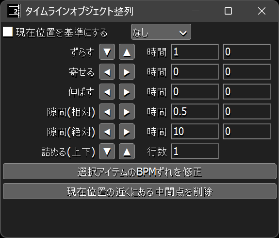

# 🐍AviUtl2 タイムラインオブジェクト整列プラグイン

* aviutl2のタイムラインオブジェクトを整列させます。

## 🚀インストール

* `プラグインフォルダ`に以下のファイルを入れてください。
	* `al2` ✏️フォルダ
		* `al2_timeline_object_arranger.aux2` ✏️汎用プラグインファイル

## 🔥アンインストール

* `プラグインフォルダ`から以下のファイルを削除してください。
	* `al2` ✏️フォルダ
		* `al2_timeline_object_arranger.aux2` ✏️このファイルを削除
		* `al2_timeline_object_arranger` ✏️このフォルダを削除

## 🎨タイムラインオブジェクト整列ウィンドウ

* `カーソルフレーム基準` ✏️各種アクションの挙動が変化します。
	* どのように変化するかは各種アクションの項目を参照してください。
* `サブ時間モード` ✏️タイムラインオブジェクト整列ウィンドウ右上のコンボボックスです。
	* `サブ時間`を入力したときの挙動が変化します。
		* `サブ時間`は各アクション行の一番右のエディットボックスです。
	* `なし` ✏️サブ時間を入力しても時間に変換しません。
	* `フレーム` ✏️サブ時間にフレーム数を入力すると、それに応じて時間が更新されます。
	* `BPM` ✏️サブ時間にBPMを入力すると、それに応じて時間が更新されます。

## 💡使い方

1. aviutl2ウィンドウのメニューで`表示`➡`タイムラインオブジェクト整列`を選択します。
1. `タイムラインオブジェクト整列`ウィンドウが表示されます。
1. タイムラインでオブジェクトをフォーカスまたは選択します。
1. `タイムラインオブジェクト整列`ウィンドウでボタンを押します。
1. タイムラインオブジェクトが整列されます。

### 🚨注意事項

* ずらした先にすでにオブジェクトが存在する場合はエラーメッセージが表示されます。
* 一時的に最も下のレイヤーより更に下にオブジェクトを移動します。
* そのため、処理途中で失敗した場合は、オブジェクトがかなり下のレイヤーに移動する可能性があります。
* その場合は、aviutl2のアンドゥ機能を使って元の位置に戻してください。

### ⚡️ずらす▼

* 選択オブジェクトが存在する最も上のレイヤーを基準に下に向かってずらします。
* `時間`で指定された量だけ選択オブジェクトをずらします。
* ずれる量は、レイヤー毎に0倍、1倍、2倍、3倍・・・と増えていきます。

### ⚡️ずらす▲

* 選択オブジェクトが存在する最も下のレイヤーを基準に上に向かってずらします。
* `時間`で指定された量だけ選択オブジェクトをずらします。
* ずれる量は、レイヤー毎に0倍、1倍、2倍、3倍・・・と増えていきます。

### ⚡️寄せる◀

* 一番左にある選択オブジェクトの開始位置に寄せます。
* `カーソルフレーム基準`を有効にしている場合はカーソルフレーム位置まで左寄せします。
* `時間`で指定されている値が基準位置から減算されます。

### ⚡️寄せる▶

* 一番右にある選択オブジェクトの終了位置に寄せます。
* `カーソルフレーム基準`を有効にしている場合はカーソルフレーム位置まで右寄せします。
* `時間`で指定されている値が基準位置に加算されます。

### ⚡️伸ばす◀

* 一番左にある選択オブジェクトの開始位置まで伸ばします。
* `カーソルフレーム基準`を有効にしている場合はカーソルフレーム位置まで左に伸ばします。
* `時間`で指定されている値が基準位置から減算されます。

### ⚡️伸ばす▶

* 一番右にある選択オブジェクトの終了位置まで伸ばします。
* `カーソルフレーム基準`を有効にしている場合はカーソルフレーム位置まで右に伸ばします。
* `時間`で指定されている値が基準位置に加算されます。

### ⚡️隙間(相対)◀

* `時間`で指定されている量だけ左にずらしてオブジェクト間に隙間を作ります。
* ずれる量は、オブジェクト毎に0倍、1倍、2倍、3倍・・・と増えていきます。
* `カーソルフレーム基準`は影響しません。

### ⚡️隙間(相対)▶

* `時間`で指定されている量だけ右にずらしてオブジェクト間に隙間を作ります。
* ずれる量は、オブジェクト毎に0倍、1倍、2倍、3倍・・・と増えていきます。
* `カーソルフレーム基準`は影響しません。

### ⚡️隙間(絶対)◀

* 同一レイヤーの各オブジェクトの終了位置が`時間`で指定されている間隔になるようにオブジェクトを移動します。
* `カーソルフレーム基準`が有効の場合はカーソルフレーム位置が基準位置になります。
無効の場合は一番右のオブジェクトの終了位置が基準位置になります。
* **※オブジェクトの長さが`時間`より長い場合は必ず失敗するので注意してください。**

### ⚡️隙間(絶対)▶

* 同一レイヤーの各オブジェクトの開始位置が`時間`で指定されている間隔になるようにオブジェクトを移動します。
* `カーソルフレーム基準`が有効の場合はカーソルフレーム位置が基準位置になります。
無効の場合は一番左のオブジェクトの開始位置が基準位置になります。
* **※オブジェクトの長さが`時間`より長い場合は必ず失敗するので注意してください。**

### ⚡️詰める(上下)▼

* 選択オブジェクトが存在する最も下のレイヤーまでオブジェクトを詰めます。
* `行数`で指定された行数を一塊として処理します。
* `行数`は1以上が有効です。1未満を指定しても1として処理されます。

### ⚡️詰める(上下)▲

* 選択オブジェクトが存在する最も上のレイヤーまでオブジェクトを詰めます。
* `行数`で指定された行数を一塊として処理します。
* `行数`は1以上が有効です。1未満を指定しても1として処理されます。

### ⚡️選択オブジェクトのBPMずれを修正

* 選択オブジェクトのBPMずれを修正します。
* `カーソルフレーム基準`が有効の場合はカーソルフレーム位置が基準位置になります。

### ⚡️カーソルフレーム位置の近くにある中間点を削除

選択オブジェクト内のカーソルフレーム位置に一番近い中間点を削除します。

### 🏷️設定を初期化する

1. aviutl2を起動していない状態で`プラグインフォルダ\al2\al2_timeline_object_arranger\config`を削除してください。

## 🔖更新履歴

* 🔖r1 2026年10月12日
	* 🎉初版
